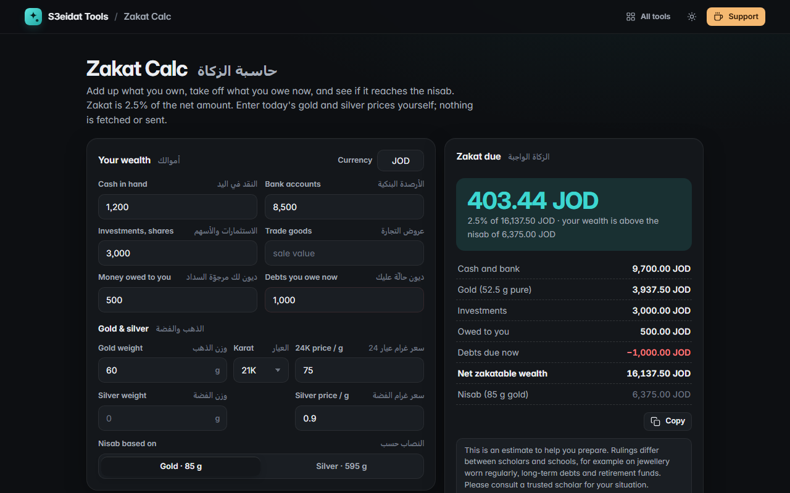

# Zakat Calc

> Calculate zakat on savings, gold, silver and other assets, with English and Arabic labels (حاسبة الزكاة). Free, private, and it runs entirely in your browser.

### ▶ [Open Zakat Calc](https://s3eidat.github.io/zakat-calc/)



## Features

- Inputs for **cash, bank accounts, investments, trade goods, money owed to you** and **debts due now** (deducted)
- **Gold** by weight and karat (24K, 22K, 21K, 18K), converted to pure gold; **silver** by weight
- **You enter today's gold and silver price per gram**: nothing is fetched, so it works offline and stays private
- **Nisab** by gold (85 g) or silver (595 g), your choice, and how far above or below it you are
- **Zakat = 2.5%** of net zakatable wealth, with a clear breakdown you can copy
- Bilingual **English / Arabic** labels and explanation; inputs remembered on this device

**Please consult a scholar.** This is an estimate to help you prepare. Rulings differ between scholars and schools, for example on jewellery worn regularly, long-term debts and retirement funds, and zakat is due only on wealth held for a full lunar year (hawl).

## Privacy

Your financial details never leave your device. There is no server, no account, no analytics.
The page ships with a strict Content-Security-Policy (`connect-src 'self'`), so the browser
itself blocks any attempt to send data anywhere.

## Run it yourself

It's plain HTML, CSS and JavaScript with no build step:

```bash
git clone https://github.com/s3eidat/zakat-calc
cd zakat-calc
python -m http.server 8000
```

Then open http://localhost:8000.

## Support

If this saved you time, **[buy me a coffee ☕](https://s3eidat.github.io/coffee/)**. It keeps every tool free.

---

Part of **[S3eidat Tools](https://s3eidat.github.io/)**: 100+ free, private tools that run in your browser. MIT licensed.
